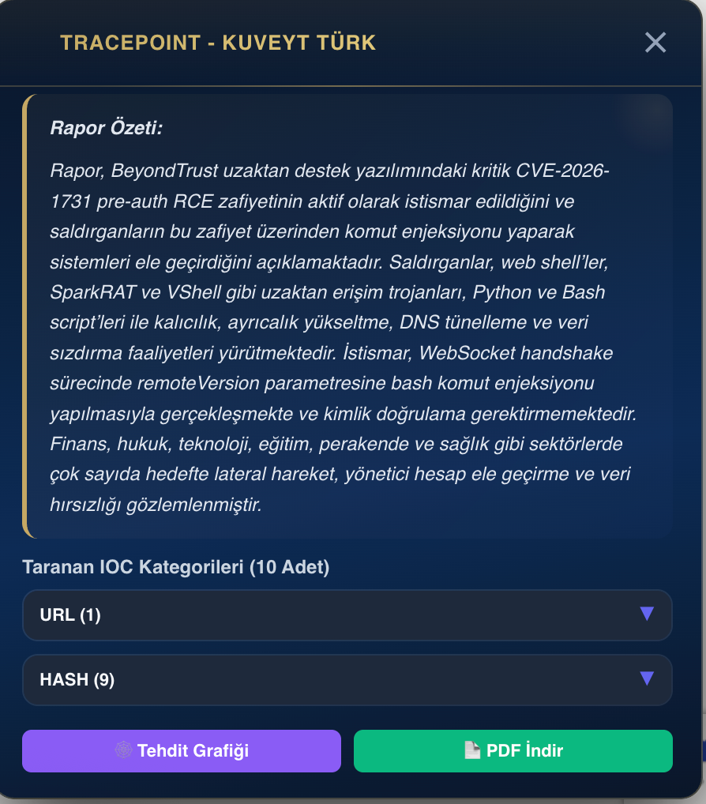
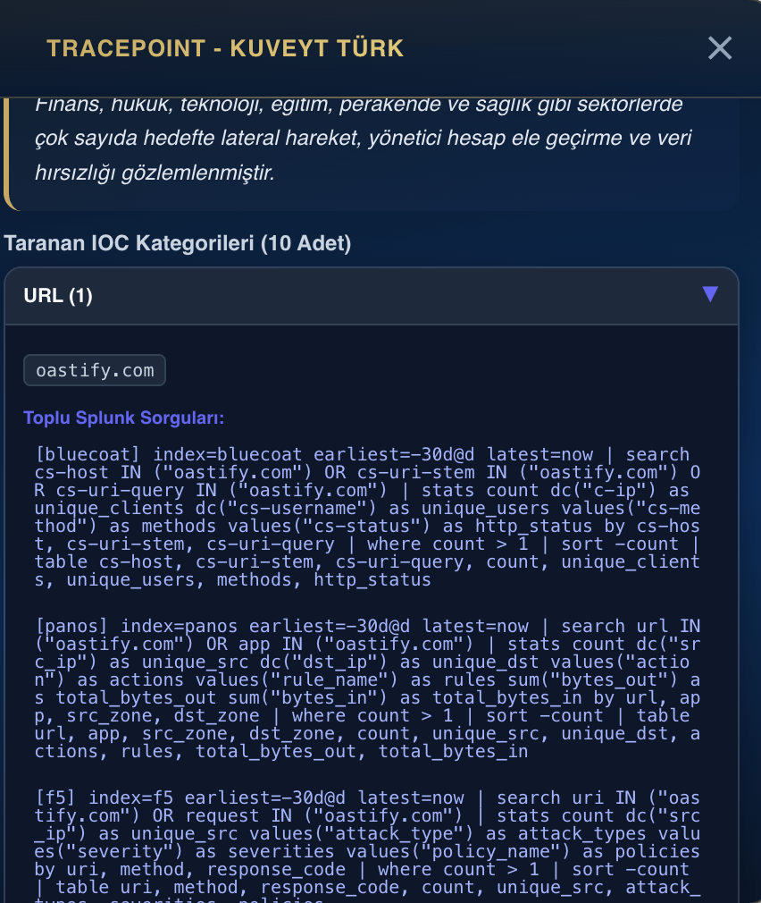
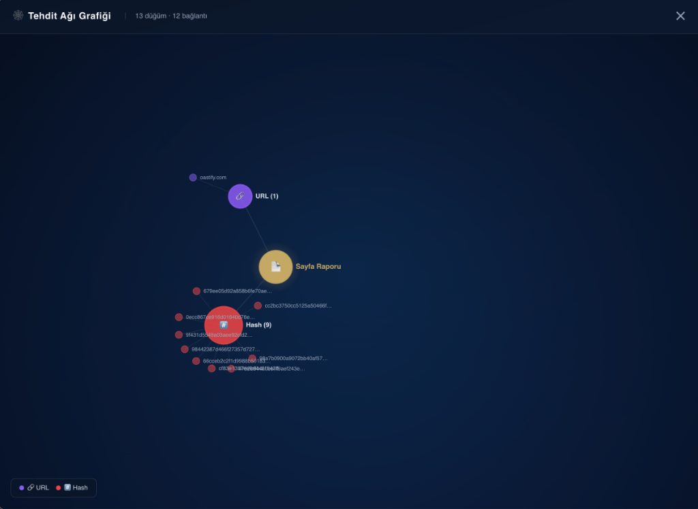
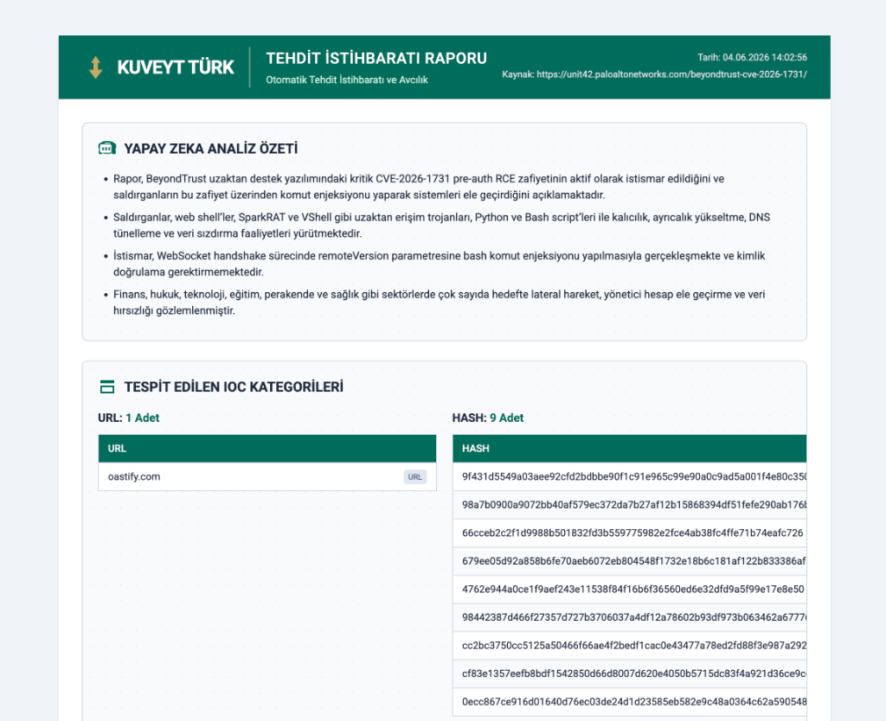

# 🛡️ TracePoint - Siber Güvenlik İstihbarat Asistanı


**TracePoint**, Siber Güvenlik Operasyon Merkezleri (SOC) bünyesindeki siber güvenlik analistleri için tasarlanmış, güçlü, yapay zeka destekli ve modern bir Chrome eklentisidir. Hedefi, tehdit analizi süreçlerini tek bir merkezde toplamak, otomatize etmek ve analistlerin daha hızlı, daha isabetli kararlar almasını sağlamaktır.

---

## ✨ Öne Çıkan Özellikler

### 🔍 Çoklu OSINT & İstihbarat Taraması
IP, Hash, Domain, URL ve E-Posta adreslerini tek tıkla **VirusTotal, AbuseIPDB, URLScan, AlienVault OTX, Sucuri, USOM, HaveIBeenPwned, Spamhaus** gibi global istihbarat kaynaklarında eşzamanlı olarak sorgular.

### 🧠 LLM Destekli Yapay Zeka Yorumu
Analiz sonuçlarını, **Azure OpenAI (GPT-5.1 vb.)** kullanarak saniyeler içinde analiz eder. Analistlere uzun verileri okumak yerine, risk seviyesini ve alınması gereken aksiyonları içeren yönetici özetleri (Executive Summary) sunar.

### 🌐 Sayfa İçi Rapor Taraması (Page Scanner)
Açık olan sekmedeki bir tehdit makalesini veya siber güvenlik raporunu tek tıkla okur. Sayfa içindeki tüm IOC'leri (IP, Hash, URL, Email) otomatik tespit eder, doğrular ve toplu halde repütasyon taraması yapar.

### 🕸️ İnteraktif Tehdit Ağı Grafiği (Threat Graph)
Bulunan zararlı IOC'ler arasındaki ilişkileri görselleştirmek için **D3.js** tabanlı tam ekran "Tehdit Ağı Grafiği" oluşturur. Nodlar (IP, Hash, Domain) arasındaki bağlantıları sürükle-bırak dinamikleriyle analiz etmenizi sağlar.

### 🎯 Dinamik SPL (Splunk) Entegrasyonu
Seçilen IOC türüne ve tespit edilen OSINT bağlamına (örn: Proxy, Firewall, WAF, Windows Sysmon) göre anında çalıştırılabilir gelişmiş **Splunk (SPL) sorguları** üretir.
*Üstelik kopyalamaya gerek kalmadan, doğrudan eklenti üzerinden kurumunuzun Splunk ortamına istek atabilir ve logları tablolar halinde anında eklentide görebilirsiniz!*

### 🔓 CVE Zafiyet Analizi
Sayfalarda geçen **CVE (Örn: CVE-2024-XXXX)** numaralarına tıkladığınızda otomatik olarak **NIST NVD API**'sine bağlanır. Zafiyetin CVSS skorunu, özetini, zafiyetli sistemleri ve yama bilgilerini şık bir Modal (Overlay) içinde sunar.

### 🔔 İşletim Sistemi Bildirimleri (Desktop Notifications)
Arka planda yürütülen uzun taramalar tamamlandığında veya hata alındığında, sizi işletim sistemi üzerinden anında uyarır.

### 💎 Modern ve Premium UI (Glassmorphism)
Uygulama arayüzü; modern web trendlerine uygun olarak **Glassmorphism (Buzlu cam)** efekti, akıcı mikro-animasyonlar, gece modu (Dark Theme) ve estetik renk paletleri ile tamamen premium bir analist deneyimi sunar.

---

## 📸 Ekran Görüntüleri

> **Not:** Görsellerinizi proje klasörüne ekleyip aşağıdaki linkleri kendi görsellerinize (`assets/screenshot1.png` gibi) bağlayabilirsiniz.

| OSINT & Tehdit İstihbaratı | Yapay Zeka (LLM) Özeti | Dinamik SPL (Splunk) | Sayfa Raporu & Toplu Analiz |
|:---:|:---:|:---:|:---:|
|  |  |  |  |

---

## 🛠️ Teknoloji Yığını

- **Frontend:** HTML5, Vanilla CSS (Glassmorphism), Vanilla JavaScript, D3.js, Chrome Extension API (Manifest V3)
- **Backend:** Python, FastAPI, Uvicorn, httpx, python-dotenv
- **AI / LLM:** Azure OpenAI (GPT-5.1-ptu)
- **SIEM:** Splunk REST API

---

## 🚀 Kurulum ve Başlangıç

### 🌟 Tek Tıkla Otomatik Kurulum (Önerilen)

Projeyi başka bir bilgisayarda (Windows) hızlıca ayağa kaldırmak için hazırlanan `setup_and_run.ps1` PowerShell betiğini kullanabilirsiniz. Bu betik;
1. Python'un kurulu olup olmadığını kontrol eder.
2. Gerekli sanal ortamı (venv) otomatik oluşturur.
3. Bağımlılıkları (`requirements.txt`) otomatik yükler.
4. Eksikse varsayılan bir `.env` dosyası oluşturur.
5. Sunucuyu otomatik olarak başlatır.

**Nasıl Çalıştırılır?**
1. Proje ana dizininde sağ tıklayıp **"PowerShell'de Aç" (Open in Terminal)** seçeneğini seçin.
2. Aşağıdaki komutu çalıştırın:
   ```powershell
   .\setup_and_run.ps1
   ```
   *(Eğer yetki hatası alırsanız PowerShell'i yönetici olarak çalıştırıp `Set-ExecutionPolicy -Scope Process -ExecutionPolicy Bypass` komutunu girdikten sonra tekrar deneyin.)*

---

### 1. Backend Kurulumu (Manuel)

Backend servisi FastAPI ile yazılmıştır ve OSINT API'lerine ve LLM modellerine güvenli bir şekilde bağlanır.

```bash
cd backend
python -m venv venv
source venv/bin/activate
pip install -r requirements.txt
```

`.env` dosyasını `backend` dizininde oluşturun ve ortamınıza göre doldurun:

```env
# Splunk Ayarları
SPLUNK_URL=https://your-splunk-instance:8089
SPLUNK_TOKEN=your-splunk-rest-token
SPLUNK_VERIFY_SSL=False

# Azure OpenAI LLM Ayarları
LLM_MODEL=gpt-5.1-ptu
LLM_URL=https://apim-ai-management.azure-api.net/.../chat/completions?api-version=2024-12-01-preview
LLM_API_VERSION=2024-12-01-preview
LLM_API_KEY=your-api-key
```

Uygulamayı başlatın:
```bash
python main.py
```

### 2. Frontend (Chrome Eklentisi) Kurulumu

1. Google Chrome veya Chromium tabanlı bir tarayıcı açın.
2. Adres çubuğuna `chrome://extensions/` yazarak uzantılar sayfasına gidin.
3. Sağ üst köşeden **"Geliştirici modu" (Developer mode)** seçeneğini aktif hale getirin.
4. Sol üstten **"Paketlenmemiş öğe yükle" (Load unpacked)** butonuna tıklayın.
5. Projedeki `frontend/extension` veya `frontend` klasörünü seçin.

---

## 💡 Kullanım İpuçları

1. Herhangi bir web sitesinde (Örn: BleepingComputer, The Hacker News) bir makale okurken eklenti pop-up'ını açıp **"Sayfa Raporunu Tara"** butonuna basın.
2. Tarama sonucunda tespit edilen IP'lerin yanındaki **"Tehdit Grafiğini Göster"** ikonuna basarak IP/Hash ilişkilerini analiz edin.
3. Splunk entegrasyonu aktifse, eklentinin size sunduğu **SPL sorgularını "⚡ Çalıştır"** butonu ile tek tıkla test edin.
4. Sayfada dolaşırken karşılaştığınız CVE kodlarının **üzerine tıklayarak** anında NIST destekli Modal analiz penceresini açın.

---

## 🤝 Katkıda Bulunma

Bu proje kapalı kaynaklı ve iç operasyonlar için tasarlanmıştır. Geliştirici ekibindeyseniz, branch oluşturup PR açarak katkıda bulunabilirsiniz. Eklenen yeni kütüphaneleri `requirements.txt` dosyasına işlemeyi unutmayın.
